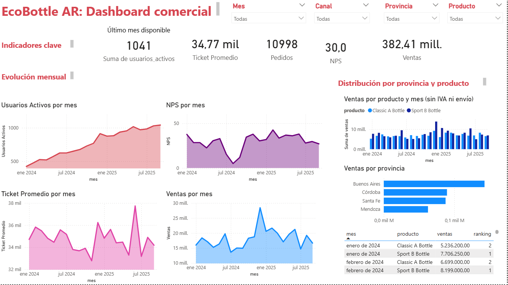
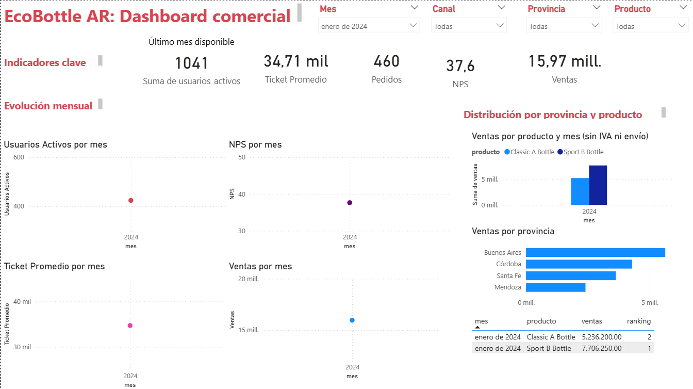

# EcoBottle AR: data warehouse y dashboard comercial

 Trabajo práctico final de **Introducción al Marketing Online y los Negocios Digitales**
 Licenciatura en Ciencia de Datos, Universidad Austral
 Hecho por: Inés Galdeano
 Entrega: 4 de noviembre de 2026

## Índice

1. [Resumen](#1-resumen)
2. [Cómo ejecutarlo](#2-cómo-ejecutarlo)
3. [Arquitectura y flujo de datos](#3-arquitectura-y-flujo-de-datos)
4. [Modelo estrella](#4-modelo-estrella)
5. [Diccionario de datos](#5-diccionario-de-datos)
6. [Supuestos y decisiones](#6-supuestos-y-decisiones)
7. [KPIs y consultas clave](#7-kpis-y-consultas-clave)
8. [Dashboard](#8-dashboard)
9. [Hallazgos](#9-hallazgos)

## 1. Resumen

EcoBottle AR vende dos botellas reutilizables (Classic A y Sport B) por una tienda
online y cuatro tiendas físicas. Este proyecto transforma los 13 CSV del sistema de
ventas (carpeta `raw/`) en un **data warehouse con modelo estrella (Kimball)**,
escrito en **SQL sobre DuckDB**, y lo presenta en un **dashboard de Power BI** para
el área comercial.

Qué contiene:

- **11 dimensiones y 6 tablas de hechos** (ventas, ítems de venta, NPS, sesiones web,
  pagos y envíos).
- **4 data marts** (ventas, producto, NPS y usuarios, todos mensuales) que dejan los
  KPIs ya calculados en SQL.
- **6 KPIs**: Ventas, Usuarios activos, Ticket promedio, NPS, Ventas por provincia y
  Ranking mensual por producto.
- **Diccionario de datos** de las 21 tablas y un **dashboard** con filtros por mes,
  canal, provincia y producto.

Totales de control (si tu corrida da estos números, el pipeline está bien):

| Indicador | Valor |
|---|---|
| Ventas (pedidos PAID y FULFILLED) | $382.410.636 en 10.998 pedidos |
| Ticket promedio | $34.771 |
| NPS global | 30,0 (Tiendas Físicas 40,9 y Tienda Online 24,0) |
| Usuarios activos (septiembre 2025) | 1.041 |

## 2. Cómo ejecutarlo

### Requisitos

- Python 3.9 o superior y Git.
- Power BI Desktop (solo existe para Windows) si querés abrir el dashboard
  interactivo. Si no, alcanza con las capturas de la [sección 8](#8-dashboard).

### Pasos

```bash
git clone https://github.com/InesGaldeano/practica-imond.git
cd practica-imond
python -m venv venv
venv\Scripts\activate          # Windows. En Mac/Linux: source venv/bin/activate
pip install -r requirements.txt
python run_sql.py
```

Qué hace cada comando:

1. `git clone` descarga el repositorio y `cd` entra a la carpeta.
2. `python -m venv venv` crea un entorno virtual (una instalación de Python aislada
   para este proyecto) y `venv\Scripts\activate` lo activa.
3. `pip install -r requirements.txt` instala las librerías del proyecto (DuckDB).
4. `python run_sql.py` arma el warehouse desde cero:
   - crea la base `warehouse.duckdb`;
   - ejecuta en orden los archivos de `sql/` (`01_dimensiones.sql`, `02_hechos.sql`,
     `03_consultas.sql` y `04_marts.sql`) y muestra el resultado de cada `SELECT`;
   - exporta las **21 tablas** como CSV a `dw/`;
   - dibuja el modelo en `dw/modelo_estrella.md`.

Como todo se reconstruye desde cero en cada corrida, se puede repetir sin borrar nada
a mano. Los archivos de `raw/` no se modifican nunca.

### Opciones útiles

| Comando | Para qué sirve |
|---|---|
| `python run_sql.py --explorar` | Abre las tablas de origen en DuckDB para probar consultas. No toca `dw/`. |
| `python run_sql.py --ui` | Arma el warehouse y abre DuckDB con las tablas del modelo. |
| `python generator/validate_raw.py` | Valida los datos de origen y muestra la tabla mensual de referencia para comparar los KPIs. |

### Abrir el dashboard

Abrí `dashboard/TP_PowerBI.pbix` con Power BI Desktop. Los datos ya vienen guardados
dentro del archivo. Si después de volver a correr `run_sql.py` querés actualizarlos,
Power BI lee los CSV de `dw/` desde la ruta donde se importaron, así que puede que
tengas que apuntarla a tu copia del repo (Inicio, Transformar datos, Configuración de
origen de datos).


## 3. Arquitectura y flujo de datos

```
raw/ (13 CSV de origen)
   │
   ▼
sql/01_dimensiones.sql  →  sql/02_hechos.sql  →  sql/03_consultas.sql  →  sql/04_marts.sql
   (dimensiones)            (tablas de hechos)     (KPIs de control)       (data marts)
   │
   ▼
python run_sql.py  →  warehouse.duckdb  →  dw/ (21 CSV)
                                              │
                                              ▼
                                  Power BI (dashboard/TP_PowerBI.pbix)
```

Estructura del repositorio:

```
raw/                 datos de origen (no se modifican)
sql/                 transformaciones: 01_dimensiones, 02_hechos, 03_consultas y 04_marts
run_sql.py           ejecuta los archivos de sql/ y exporta el warehouse a dw/
dw/                  data warehouse: 21 CSV generados por run_sql.py y el diagrama del modelo
dashboard/           TP_PowerBI.pbix
docs/                diccionario_datos.md
assets/              DER del origen y capturas del dashboard
generator/           programa que generó los datos de raw/ y validate_raw.py
requirements.txt     dependencias (DuckDB)
```

La base `warehouse.duckdb` y el entorno virtual `venv/` no se suben a GitHub: se recrean con los pasos de la [sección 2](#2-cómo-ejecutarlo).

### Cómo se procesan los datos

1. **Origen (`raw/`):** los CSV tal como los entrega el sistema de ventas. Nunca se modifican.
2. **Modelo estrella (`01` y `02`):** las dimensiones y las tablas de hechos se cargan desde `raw` con SQL dentro de DuckDB. Primero se carga y después se transforma dentro de la base (enfoque ELT).
3. **Consultas de control (`03`):** calculan los 6 KPIs sobre el modelo estrella y se verifican contra `generator/validate_raw.py`.
4. **Data marts (`04`):** tablas pequeñas, ya resumidas por mes, que dejan cada KPI calculado.
5. **Exportación (`run_sql.py`):** cada tabla se guarda como CSV en `dw/`.
6. **Dashboard:** Power BI importa solo `dim_mes`, `dim_channel` y los 4 marts.

### ¿Por qué hay data marts?

- **Las medidas se calculan en SQL y el dashboard solo las muestra.** Así hay un único lugar donde se define cada KPI, y Power BI usa solo `SUM` y `DIVIDE`, sin JOIN ni cruces sobre tablas de hechos.
- **Hay medidas que no se pueden sumar.** Los usuarios activos son clientes distintos (un cliente activo en dos meses se contaría dos veces), y el ticket promedio y el NPS son cocientes. Los marts guardan los componentes (por ejemplo, promotores y detractores) para recalcularlos bien con cualquier filtro.
- **Son más livianos.** Los marts tienen entre 21 y 168 filas, contra las más de 100.000 de `fact_web_session`.

| Data mart | Grano (qué es una fila) | Filas | Alimenta |
|---|---|---:|---|
| `mart_ventas_mensual` | mes × canal × provincia | 168 | Ventas, Pedidos, Ticket y Ventas por provincia |
| `mart_producto_mensual` | mes × producto | 42 | Ranking mensual por producto |
| `mart_nps_mensual` | mes × canal | 42 | NPS |
| `mart_usuarios_mensual` | mes | 21 | Usuarios activos |

Además, `dim_mes` (21 filas, una por mes) es la dimensión compartida por los cuatro marts: es lo que permite que un solo filtro de fecha afecte a todo el dashboard.


## 4. Modelo estrella

El modelo sigue el enfoque de Kimball: tablas de **hechos** (eventos medibles) en el centro y **dimensiones** (el contexto: quién, cuándo, dónde y qué) alrededor. Cada hecho define su **grano**, es decir, qué representa una fila, y no mezcla granos distintos.

```mermaid
erDiagram
    dim_carrier ||--o{ fact_shipment : "carrier_key"
    dim_channel ||--o{ fact_nps : "channel_id"
    dim_channel ||--o{ fact_payment : "channel_id"
    dim_channel ||--o{ fact_sales : "channel_id"
    dim_channel ||--o{ fact_sales_item : "channel_id"
    dim_channel ||--o{ fact_shipment : "channel_id"
    dim_customer ||--o{ fact_nps : "customer_id"
    dim_customer ||--o{ fact_payment : "customer_id"
    dim_customer ||--o{ fact_sales : "customer_id"
    dim_customer ||--o{ fact_sales_item : "customer_id"
    dim_customer ||--o{ fact_shipment : "customer_id"
    dim_customer ||--o{ fact_web_session : "customer_id"
    dim_date ||--o{ fact_nps : "date_id"
    dim_date ||--o{ fact_payment : "date_id"
    dim_date ||--o{ fact_sales : "date_id"
    dim_date ||--o{ fact_sales_item : "date_id"
    dim_date ||--o{ fact_shipment : "delivered_date_id"
    dim_date ||--o{ fact_shipment : "shipped_date_id"
    dim_date ||--o{ fact_web_session : "date_id"
    dim_device ||--o{ fact_web_session : "device_key"
    dim_location ||--o{ fact_sales : "location_id"
    dim_location ||--o{ fact_sales_item : "location_id"
    dim_payment_method ||--o{ fact_payment : "payment_method_key"
    dim_product ||--o{ fact_sales_item : "product_key"
    dim_store ||--o{ fact_sales : "store_id"
    dim_store ||--o{ fact_sales_item : "store_id"
    dim_traffic_source ||--o{ fact_web_session : "traffic_source_key"
    fact_sales ||--o{ fact_payment : "order_id"
    fact_sales ||--o{ fact_sales_item : "order_id"
    fact_sales ||--o{ fact_shipment : "order_id"
    dim_carrier {
        INTEGER carrier_key PK
        VARCHAR carrier
    }
    dim_channel {
        INTEGER channel_id PK
        VARCHAR code
        VARCHAR name
    }
    dim_customer {
        INTEGER customer_id PK
        VARCHAR email
        VARCHAR first_name
        VARCHAR last_name
        VARCHAR phone
        VARCHAR status
        TIMESTAMP created_at
    }
    dim_date {
        INTEGER date_id PK
        DATE full_date
        INTEGER day
        INTEGER month
        INTEGER year
        INTEGER quarter
    }
    dim_device {
        INTEGER device_key PK
        VARCHAR device
    }
    dim_location {
        INTEGER location_id PK
        VARCHAR address_line
        VARCHAR city
        VARCHAR province_name
        VARCHAR province_code
        VARCHAR postal_code
        VARCHAR country_code
    }
    dim_mes {
        DATE mes PK
        INTEGER anio
        INTEGER nro_mes
    }
    dim_payment_method {
        INTEGER payment_method_key PK
        VARCHAR method
    }
    dim_product {
        INTEGER product_key PK
        INTEGER product_id
        VARCHAR sku
        VARCHAR name
        VARCHAR category
        VARCHAR family
        DECIMAL list_price
    }
    dim_store {
        INTEGER store_id PK
        VARCHAR store_name
        INTEGER address_id
        VARCHAR city
        VARCHAR province_name
    }
    dim_traffic_source {
        INTEGER traffic_source_key PK
        VARCHAR source
    }
    fact_nps {
        BIGINT nps_id PK
        INTEGER date_id FK
        INTEGER customer_id FK
        INTEGER channel_id FK
        SMALLINT score
        VARCHAR comment
        TIMESTAMP responded_at
    }
    fact_payment {
        BIGINT payment_id PK
        BIGINT order_id FK
        INTEGER date_id FK
        INTEGER customer_id FK
        INTEGER channel_id FK
        INTEGER payment_method_key FK
        VARCHAR status
        DECIMAL amount
        TIMESTAMP paid_at
        VARCHAR transaction_ref
    }
    fact_sales {
        BIGINT order_id PK
        INTEGER date_id FK
        INTEGER customer_id FK
        INTEGER channel_id FK
        INTEGER location_id FK
        INTEGER store_id FK
        TIMESTAMP order_date
        VARCHAR status
        VARCHAR currency_code
        DECIMAL subtotal
        DECIMAL tax_amount
        DECIMAL shipping_fee
        DECIMAL total_amount
    }
    fact_sales_item {
        BIGINT order_item_id PK
        BIGINT order_id FK
        INTEGER date_id FK
        INTEGER customer_id FK
        INTEGER channel_id FK
        INTEGER location_id FK
        INTEGER store_id FK
        INTEGER product_key FK
        VARCHAR status
        INTEGER quantity
        DECIMAL unit_price
        DECIMAL discount_amount
        DECIMAL line_total
    }
    fact_shipment {
        BIGINT shipment_id PK
        BIGINT order_id FK
        INTEGER customer_id FK
        INTEGER channel_id FK
        INTEGER carrier_key FK
        INTEGER shipped_date_id FK
        INTEGER delivered_date_id FK
        VARCHAR tracking_number
        VARCHAR status
        TIMESTAMP shipped_at
        TIMESTAMP delivered_at
        INTEGER delivery_days
    }
    fact_web_session {
        BIGINT session_id PK
        INTEGER date_id FK
        INTEGER customer_id FK
        INTEGER traffic_source_key FK
        INTEGER device_key FK
        TIMESTAMP started_at
        TIMESTAMP ended_at
        INTEGER duration_minutes
    }
    mart_nps_mensual {
        DATE mes PK
        VARCHAR canal PK
        INTEGER respuestas
        INTEGER promotores
        INTEGER detractores
        DECIMAL nps
    }
    mart_producto_mensual {
        DATE mes PK
        VARCHAR producto PK
        DECIMAL ventas
        INTEGER unidades
        INTEGER ranking
    }
    mart_usuarios_mensual {
        DATE mes PK
        INTEGER usuarios_activos
        INTEGER sesiones
        INTEGER sesiones_anonimas
    }
    mart_ventas_mensual {
        DATE mes PK
        VARCHAR canal PK
        VARCHAR provincia PK
        DECIMAL ventas
        INTEGER pedidos
        DECIMAL ticket_promedio
    }
```




El diagrama lo genera `run_sql.py` en [`dw/modelo_estrella.md`](./dw/modelo_estrella.md).

### Tablas de hechos y su grano

| Hecho | Una fila representa | Filas |
|---|---|---:|
| `fact_sales` | un pedido | 11.969 |
| `fact_sales_item` | un producto dentro de un pedido | 14.573 |
| `fact_nps` | una respuesta de la encuesta NPS | 3.083 |
| `fact_web_session` | una sesión web | 100.363 |
| `fact_payment` | el pago de un pedido | 11.969 |
| `fact_shipment` | un envío | 7.009 |

### Qué dimensiones usa cada hecho

| Hecho | date | customer | channel | location | store | product | traffic_source | device | payment_method | carrier |
|---|:-:|:-:|:-:|:-:|:-:|:-:|:-:|:-:|:-:|:-:|
| `fact_sales` | ✔ | ✔ | ✔ | ✔ | ✔ | | | | | |
| `fact_sales_item` | ✔ | ✔ | ✔ | ✔ | ✔ | ✔ | | | | |
| `fact_nps` | ✔ | ✔ | ✔ | | | | | | | |
| `fact_web_session` | ✔ | ✔ | | | | | ✔ | ✔ | | |
| `fact_payment` | ✔ | ✔ | ✔ | | | | | | ✔ | |
| `fact_shipment` | ✔ | ✔ | ✔ | | | | | | | ✔ |

### Decisiones de diseño

- **Dimensiones conformadas:** `dim_date`, `dim_customer` y `dim_channel` se comparten entre varios hechos, así que un mismo filtro afecta a varios indicadores.
- **Dimensión de rol:** `fact_shipment` usa `dim_date` dos veces, para la fecha de envío y la de entrega.
- **Claves subrogadas:** `dim_product`, `dim_traffic_source`, `dim_device`, `dim_payment_method` y `dim_carrier` usan un número propio del warehouse (generado con `ROW_NUMBER`). Las demás dimensiones usan la clave del origen.
- **`dim_mes`** no se conecta a los hechos: es la dimensión compartida de los data marts y la usa el filtro de fecha del dashboard.
- **`fact_sales_item`** existe porque un pedido puede tener varios productos y el ranking por producto necesita una fila por producto. Trae el estado del pedido, porque el ítem no tiene estado propio.

## 5. Diccionario de datos

El diccionario completo está en [`docs/diccionario_datos.md`](./docs/diccionario_datos.md). Documenta, para cada una de las 21 tablas, el grano y, por columna, el tipo, la clave (PK o FK), si acepta nulos, el dominio y una descripción. Resumen:

| Tabla | Tipo | Una fila representa | Filas |
|---|---|---|---:|
| `dim_carrier` | Dimensión | un transportista | 1 |
| `dim_channel` | Dimensión | un canal de venta (ONLINE u OFFLINE) | 2 |
| `dim_customer` | Dimensión | un cliente | 3.471 |
| `dim_date` | Dimensión | un día (01/01/2024 al 30/09/2025) | 639 |
| `dim_device` | Dimensión | un tipo de dispositivo | 3 |
| `dim_location` | Dimensión | una dirección | 3.829 |
| `dim_mes` | Dimensión | un mes | 21 |
| `dim_payment_method` | Dimensión | un medio de pago | 4 |
| `dim_product` | Dimensión | un producto | 2 |
| `dim_store` | Dimensión | una tienda física | 4 |
| `dim_traffic_source` | Dimensión | una fuente de tráfico | 4 |
| `fact_sales` | Hecho | un pedido | 11.969 |
| `fact_sales_item` | Hecho | un producto dentro de un pedido | 14.573 |
| `fact_nps` | Hecho | una respuesta NPS | 3.083 |
| `fact_web_session` | Hecho | una sesión web | 100.363 |
| `fact_payment` | Hecho | el pago de un pedido | 11.969 |
| `fact_shipment` | Hecho | un envío | 7.009 |
| `mart_ventas_mensual` | Data mart | mes × canal × provincia | 168 |
| `mart_producto_mensual` | Data mart | mes × producto | 42 |
| `mart_nps_mensual` | Data mart | mes × canal | 42 |
| `mart_usuarios_mensual` | Data mart | un mes | 21 |


## 6. Supuestos y decisiones

### Datos y reglas de negocio

- Los datos son una foto del sistema tomada el 30/09/2025 y cubren pedidos del 01/01/2024 al 30/09/2025. `dim_date` cubre ese rango.
- Los montos están en pesos argentinos. Los precios de lista no incluyen IVA; el IVA es el 21 % del subtotal. Las fechas y horas están en hora de Argentina.
- Solo los pedidos `PAID` y `FULFILLED` cuentan como venta. `CREATED`, `CANCELLED` y `REFUNDED` no.
- **Ventas por provincia** se calcula con la dirección de envío. En compras en tienda, esa dirección es la de la tienda.
- **NPS:** 122 de las 3.083 respuestas son anónimas (`customer_id` nulo) y se mantienen en el cálculo. La encuesta no tiene `order_id`, por eso se relaciona con el cliente y el canal, no con el pedido.
- **Usuarios activos** cuenta clientes identificados distintos (`COUNT(DISTINCT customer_id)`). Las sesiones anónimas (70.751 de 100.363, cerca del 70 %) no entran en el conteo. Como es un conteo de distintos, **no se puede sumar entre meses**: la tarjeta del dashboard muestra el último mes (septiembre 2025: 1.041).
- Los clientes con `status = 'I'` (dieron de baja su cuenta) conservan sus compras en las ventas.

### Modelo

- Las dimensiones usan la clave del origen como PK, excepto `dim_product` y las cuatro dimensiones nuevas, que usan una clave subrogada generada con `ROW_NUMBER`.
- Los valores vacíos de `source`, `device`, `method` y `carrier` se guardan como `unknown` con `COALESCE` (hoy no hay vacíos).
- `fact_payment.date_id` sale de `paid_at` y queda `NULL` si el pago no se concretó. `fact_shipment` tiene dos fechas (envío y entrega) que pueden ser `NULL`.

### Dashboard

- Los cálculos se hacen en SQL, en data marts (`sql/04_marts.sql`). Power BI solo muestra: usa `SUM` y `DIVIDE` sobre los marts, sin JOIN ni cruces sobre tablas de hechos.
- Los filtros se relacionan a través de `dim_mes` y `dim_channel`.
- Las tarjetas de Ventas y el gráfico “Ventas por mes” usan total_amount (cabecera del pedido, con IVA y envío): $382,41 M. El gráfico y el ranking por producto usan line_total (suma de las líneas, sin IVA ni envío): $309,89 M. La diferencia son los $72,5 M de IVA y envío, que no se pueden repartir por producto.
- La tarjeta de Usuarios activos se alimenta de mart_usuarios_ultimo_mes, una tabla de una sola fila que el ETL arma con el último mes disponible. No responde al filtro de Mes a propósito: es un conteo de clientes distintos y no se puede sumar entre meses.
- El mart de NPS guarda promotores y detractores, para recalcular el NPS global como cociente de sumas (el NPS no se puede promediar entre meses).
- En Power Query se usó la configuración regional Inglés (Estados Unidos), porque los CSV usan punto decimal. `postal_code` es entero en el origen y `VARCHAR(20)` en `dim_location`.

### Herramientas

- Este trabajo usa SQL sobre DuckDB (`sql/` y `run_sql.py`), que es la estructura del repositorio base que entregó la cátedra, y Power BI para el dashboard.

### Limitaciones conocidas

- `fact_web_session.duration_minutes` y `fact_shipment.delivery_days` se calculan con `DATE_DIFF`, que cuenta cuántas veces cambia el minuto o el día y no los períodos completos (una sesión de 3 min 43 s da 4). No afecta a ninguno de los 6 KPIs.
- Algunos dominios del diccionario de datos son valores observados en los datos (por ejemplo `shipping_fee` o `province_code`) y no restricciones del esquema.

## 7. KPIs y consultas clave

Regla común: una venta es un pedido con estado `PAID` o `FULFILLED`.

| KPI | Cómo se calcula | Por qué así |
|---|---|---|
| Ventas | `SUM(total_amount)` | El filtro de estado es el mismo en todos los KPIs de venta |
| Ticket promedio | `SUM(total_amount) / COUNT(*)` | El mismo `WHERE` en numerador y denominador; nunca se promedian promedios |
| Usuarios activos | `COUNT(DISTINCT customer_id)` por mes | Ignora los `NULL` (visitantes anónimos), que se informan aparte |
| NPS | `(% de 9-10) − (% de 0-6)` | Sin JOIN a `dim_customer`, para no perder las respuestas anónimas; los puntajes 7 y 8 cuentan en el total pero no suman ni restan |
| Ventas por provincia | Suma por provincia de la dirección de envío | `LEFT JOIN` para no perder pedidos sin ubicación |
| Ranking mensual por producto | `RANK()` por mes sobre el total del ítem (`line_total`) | Se calcula sobre `fact_sales_item`, porque un pedido puede tener varios productos |

Las consultas completas están en [`sql/03_consultas.sql`](./sql/03_consultas.sql). Los data marts que alimentan el dashboard están en [`sql/04_marts.sql`](./sql/04_marts.sql). Dos ejemplos:

```sql
-- Ticket promedio por mes
SELECT d.year, d.month, ROUND(SUM(f.total_amount) / COUNT(*), 2) AS ticket_promedio
FROM fact_sales AS f
JOIN dim_date AS d ON d.date_id = f.date_id
WHERE f.status IN ('PAID', 'FULFILLED')
GROUP BY d.year, d.month
ORDER BY d.year, d.month;
```

```sql
-- NPS por mes = (% de 9-10) - (% de 0-6) sobre todas las respuestas
SELECT d.year, d.month, COUNT(*) AS respuestas,
       ROUND(100.0 * (SUM(CASE WHEN n.score >= 9 THEN 1 ELSE 0 END)
                    - SUM(CASE WHEN n.score <= 6 THEN 1 ELSE 0 END)) / COUNT(*), 1) AS nps
FROM fact_nps AS n
JOIN dim_date AS d ON d.date_id = n.date_id
GROUP BY d.year, d.month
ORDER BY d.year, d.month;
```

**Verificación:** `generator/validate_raw.py` imprime una tabla mensual de referencia calculada desde los datos de origen. Se comparó mes a mes con la salida de `03_consultas.sql` y coinciden los 21 meses. Además, los totales de cada mart se controlaron contra las tablas de hechos.

## 8. Dashboard

El dashboard está hecho en Power BI y se entrega en [`dashboard/TP_PowerBI.pbix`](./dashboard/TP_PowerBI.pbix). Para abrirlo hace falta Power BI Desktop (solo Windows); por eso se incluyen también las capturas.



**Estructura** (una página, de arriba hacia abajo):

1. **Encabezado con filtros:** Mes, Canal, Provincia y Producto.
2. **Indicadores clave:** Ventas, Pedidos, Ticket promedio, Usuarios activos y NPS.
3. **Evolución mensual:** gráficos de líneas de Ventas, NPS, Ticket promedio y Usuarios activos por mes.
4. **Distribución por provincia y producto:** ventas por provincia, ventas por producto y mes, y tabla de ranking mensual por producto.

**Valores de control** (sin filtros): Ventas $382,41 M, 10.998 pedidos, ticket $34,77 mil, NPS 30,0 y 1.041 usuarios activos (septiembre 2025).

Con el filtro de Mes en enero 2024 las ventas son $15,97 M y el NPS 37,6:



**Medidas de Power BI** (solo `SUM` y `DIVIDE` sobre los marts):

```
Ventas           = SUM(mart_ventas_mensual[ventas])
Pedidos          = SUM(mart_ventas_mensual[pedidos])
Ticket Promedio  = DIVIDE([Ventas], [Pedidos])
NPS              = DIVIDE(SUM(mart_nps_mensual[promotores]) - SUM(mart_nps_mensual[detractores]), SUM(mart_nps_mensual[respuestas])) * 100
Usuarios Activos = SUM(mart_usuarios_mensual[usuarios_activos])
```

El ticket y el NPS son cocientes, por eso se recalculan como suma sobre suma y no se promedian.

**Qué filtra cada segmentador:**

- **Mes** filtra todo, salvo la tarjeta de Usuarios activos (siempre muestra el último mes).
- **Canal** filtra Ventas, Pedidos, Ticket y NPS (los marts que tienen canal).
- **Provincia** filtra solo las visuales de ventas, porque NPS, sesiones y productos no tienen ubicación.
- **Producto** filtra solo el ranking, porque las ventas no se abren por producto.

Son limitaciones del dato, no del dashboard.

## 9. Hallazgos

- **El NPS es mucho mejor en tienda:** Tiendas Físicas (OFFLINE) 40,9 contra Tienda Online (ONLINE) 24,0, casi 17 puntos de diferencia (NPS global 30,0 sobre 3.083 respuestas).
- **Diciembre 2024 es el pico de ventas:** 785 pedidos y $28,4 M. El resto de los meses se mueve entre $13,6 M y $21,7 M.
- **El NPS tuvo una caída fuerte en agosto 2024** (5,0), se recuperó a 34,6 en octubre y tuvo su máximo en febrero 2025 (42,6).
- **Los usuarios activos crecen casi sin pausa** (de 424 en enero 2024 a 1.041 en septiembre 2025), mientras que las ventas mensuales se mueven entre $13,6 M y $21,7 M, salvo el pico de diciembre 2024.
- **Alrededor del 70 % de las sesiones son anónimas**, así que Usuarios activos no refleja a todos los visitantes.
- **Ventas por provincia:** Buenos Aires lidera con $142,7 M (37,3 % del total; 4.098 pedidos), seguida por Córdoba ($89,5 M; 23,4 %), Santa Fe ($87,5 M; 22,9 %) y Mendoza ($62,6 M; 16,4 %).
- **El ranking de productos alterna** entre Classic A y Sport B, sin un ganador permanente.

### Ideas para ampliar el dashboard

Cada idea usaría datos que ya están en el modelo y requeriría un data mart nuevo en SQL, con la misma regla de que Power BI solo muestra.

- **Ventas por tienda física:** `dim_store` ya está en el modelo; falta un mart por tienda.
- **Tráfico por fuente y dispositivo:** sesiones por `ads`, `direct`, `referral` u `organic` (`dim_traffic_source`, `dim_device`).
- **Logística:** tiempos y estados de envío (`fact_shipment`) para explorar si explican la diferencia de NPS entre online y tiendas. Es una hipótesis a probar, no un resultado.
- **Pagos:** medios de pago y pagos fallidos o reembolsados (`fact_payment`: 565 fallidos y 405 reembolsados sobre 11.969 pagos).
